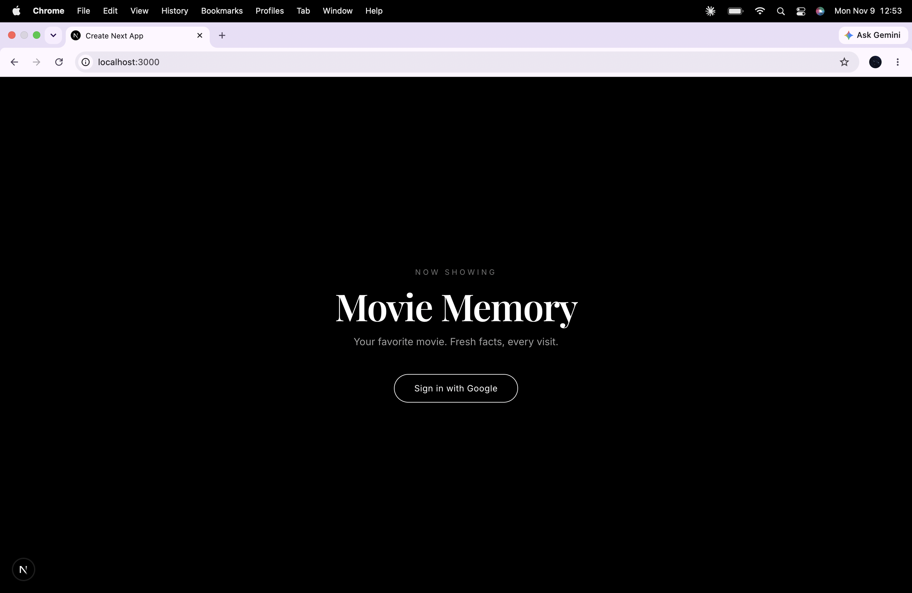
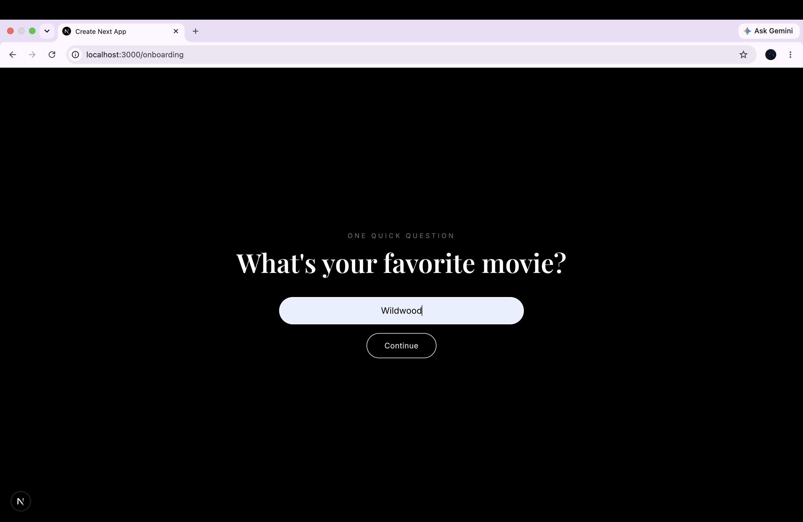
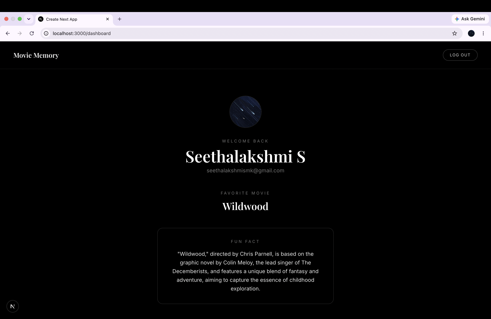

# Movie Memory

A full-stack Next.js app where users sign in with Google, save their favorite movie, and get AI-generated fun facts about it.

**Variant chosen: A (Backend-Focused: caching and correctness)**

## Screenshots

**Landing page**



**Onboarding (first-time users)**



**Dashboard**



## Tech Stack

- Next.js 16 (App Router) + TypeScript
- React + TailwindCSS
- Postgres (Neon) + Prisma 7
- Google OAuth via Auth.js (NextAuth v5)
- OpenAI API (`gpt-4o-mini`)
- Vitest for tests

## Setup

### 1. Prerequisites

- Node.js 20+
- A Postgres database (local or hosted, e.g. Neon)
- A Google OAuth client
- An OpenAI API key

### 2. Install

```bash
git clone https://github.com/seethasmk/movie-memory.git
cd movie-memory
npm install
```

### 3. Environment variables

Copy the example file and fill in values:

```bash
cp .env.example .env
```

| Variable | Description |
|---|---|
| `DATABASE_URL` | Direct Postgres connection string (used for migrations) |
| `DATABASE_URL_POOLED` | Pooled Postgres connection string (used by the app at runtime) |
| `AUTH_SECRET` | Random secret for signing session cookies (`openssl rand -base64 32`) |
| `AUTH_GOOGLE_ID` | Google OAuth client ID |
| `AUTH_GOOGLE_SECRET` | Google OAuth client secret |
| `OPENAI_API_KEY` | OpenAI API key (server only) |

If you use a single local database, set both database URLs to the same value.

**Google OAuth setup:** in Google Cloud Console, create an OAuth client ID (Web application) with:
- Authorized JavaScript origin: `http://localhost:3000`
- Authorized redirect URI: `http://localhost:3000/api/auth/callback/google`

### 4. Database migration

```bash
npx prisma migrate dev
npx prisma generate
```

### 5. Run

```bash
npm run dev
```

Open http://localhost:3000.

### 6. Tests

```bash
npm test
```

## Architecture Overview

### Request flow

```
Landing (/)
  Not logged in  -> "Sign in with Google"
  Logged in      -> no movie? /onboarding : /dashboard

Google OAuth -> /api/auth/callback/google -> Auth.js
  -> creates User, Account, Session rows -> session cookie -> back to /

/onboarding (first time only)
  -> server action validates movie -> saves to User.favoriteMovie -> /dashboard

/dashboard
  -> reads user from DB using session ID
  -> getFact(userId) -> cache / lock / OpenAI / fallback
```

### Project structure

```
src/
  auth.ts                          Auth.js config (Google provider, Prisma adapter)
  app/
    page.tsx                       Landing page + routing for logged-in users
    onboarding/page.tsx            Favorite movie form + server action
    dashboard/page.tsx             Profile, movie, fun fact, logout
    api/auth/[...nextauth]/route.ts  Auth.js routes
    api/fact/route.ts              GET /api/fact (session-scoped)
  lib/
    prisma.ts                      Shared Prisma client
    validation.ts                  Movie input schema (zod)
    openai.ts                      OpenAI call with timeout
    facts.ts                       Cache, lock, generation, fallback
    fonts.ts                       Shared fonts
prisma/
  schema.prisma                    Data model
```

### Data model

- **User**: profile from Google (`name`, `email`, `image`, all nullable) plus `favoriteMovie` (null until onboarding).
- **Fact**: `userId`, `movie`, `text`, `createdAt`.
  - `movie` is stored on each fact so a cached fact is never served for a different movie if the user's movie changes.
  - Index on `(userId, movie, createdAt DESC)` makes "latest fact for this user and movie" a single index lookup.
  - `onDelete: Cascade` removes a user's facts when the user is deleted.
- **Account, Session**: required by the Auth.js Prisma adapter. `VerificationToken` is omitted because only Google OAuth is used (no email login).

### Fact generation (Variant A)

`getFact(userId)` in `src/lib/facts.ts`:

1. Load the user's current movie.
2. **Cache check:** find the newest fact for `(userId, movie)`. If it is under 60 seconds old, return it.
3. **Lock:** start a transaction and take a Postgres advisory lock keyed by the user (`pg_advisory_xact_lock(hashtext(userId))`).
4. **Re-check:** query again inside the lock. If another request created a fresh fact while this one waited, return that.
5. **Generate:** call OpenAI, save the new fact, return it.
6. **Fallback:** if generation fails (timeout or error), return the most recent saved fact, even if stale. If none exists, throw a user-friendly error.

**Concurrency example (two tabs refresh at the same time, no fresh fact):**
- Both tabs miss the cache.
- Tab A gets the lock, calls OpenAI, saves Fact 1, commits (lock released).
- Tab B was waiting on the lock. It re-checks, finds Fact 1 (fresh), and returns it.
- Result: one OpenAI call, one new row.

### Security

- **Server-side validation:** movie input is validated with zod in the server action (trim, collapse whitespace, 1 to 100 characters, must contain a letter or number). Browser checks are only for UX.
- **Authorization:** the user ID always comes from the server-side session, never from the request. All queries are scoped by it. `GET /api/fact` returns 401 without a session.
- **Secrets:** all keys live in `.env` (gitignored) without `NEXT_PUBLIC_`, and OpenAI and database calls run only in server code.
- **Missing Google data:** missing name shows "Movie Lover". Accounts without a profile photo get Google's default letter avatar (loaded with `referrerPolicy="no-referrer"` so Google serves it). If no image URL exists at all, the dashboard shows a circle with the user's first initial.
- **SQL injection / XSS:** Prisma parameterizes queries (including the raw lock query); React escapes rendered text.

## Why Variant A

The core risks in this app are on the backend: duplicate OpenAI calls under concurrent requests, correct cache timing, and graceful failure when an external API is down. My interests are in systems, concurrency, and security, so I chose to go deep on correctness guarantees rather than client-side state.

These are the same problems faced by AI agents that call external services like CRMs, messaging platforms, and LLMs in real time. A redundant LLM call wastes money, a race condition can send a lead two messages, and an unhandled API failure breaks the experience at the exact moment a lead is ready to convert, so I focused on making the backend correct, idempotent, and resilient first.

## Key Tradeoffs

- **Advisory lock vs alternatives:** chose a Postgres advisory lock inside a transaction. It works across multiple server instances (unlike an in-memory lock), needs no schema change (unlike a "generation in progress" flag), and releases automatically if the request crashes. Tradeoff: the transaction stays open during the OpenAI call (up to the 8s timeout), so the transaction timeout is raised to 15s.
- **Lock scope is per user,** not per user and movie. Simpler, and a user has only one active movie at a time.
- **Stale fallback:** on OpenAI failure, a stale fact is shown instead of an error. Better user experience, at the cost of occasionally showing an older fact.
- **Database sessions** (Auth.js adapter default) instead of JWT sessions: easy server-side logout and revocation, at the cost of one DB lookup per request.
- **Cache Components disabled:** every page depends on the logged-in user, so Next.js 16 prerendering offers no benefit here.
- **Stored OAuth tokens:** the Auth.js adapter saves Google tokens that this app does not use. Kept for adapter compatibility.
- **Profile data is captured at first sign-in:** Auth.js does not refresh name or photo on later logins.

## What I Would Improve With 2 More Hours

- Add a "New fact" button that calls `GET /api/fact`, with loading and error states.
- Integration tests against a real test database to verify the lock under true concurrency.
- Inline editing of the favorite movie (shared `movieSchema` is already in place).
- Strip unused OAuth tokens before saving, and refresh name and photo on each login.
- Rate limit `/api/fact` per user.
- Deploy to Vercel with Neon.

## AI Usage

- Used Claude as a pair programmer. I made the design decisions (variant choice, schema, locking approach, validation rules), reviewed every file, and tested each part.
- Debugged setup issues with it (Prisma 7 env loading, Next.js Cache Components, dependency conflicts).
